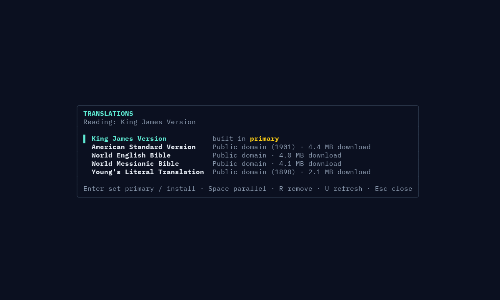

# tbible — Terminal Bible


`tbible` is a keyboard-driven Bible for your terminal. The complete KJV and its
search index are built into one executable, so it starts instantly and works
offline. You can also add public-domain translations, read them side by side,
look up Strong's numbers, keep notes and bookmarks, and copy any passage.

v2.1.2 is the current release. Windows 11 with Windows Terminal is the primary
target; Linux and macOS are fully supported. The original bash/fzf application
is still available as [legacy v1](legacy/v1/README.md) on the `v1` branch.

## Features

- **Fast.** Cold start plus the first search is roughly 20 ms, and repeated
  searches take tens of microseconds. Search stays instant even on a large
  terminal window.
- **Complete, verified KJV text.** All 66 books, 1,189 chapters, and 31,102
  verses, checked against the canonical eBible.org `eng-kjv2006` edition.
- **One search box.** Type a reference, a range, a phrase, a prefix, or a word
  with exclusions. No modes to switch and no separate reference lookup.

  ```text
  John 3:16          a single verse
  1 Cor 13:4-7       a verse range
  John 3-5           a chapter range
  John 3:16-5:2      a range across chapters
  "still waters"     an exact phrase
  love -world        include love, exclude world
  shep*              words beginning with "shep"
  john 3:16; rom 5:8 several references at once
  ```

- **Notes that keep their context.** Press `n` while a verse or passage is
  selected and the note editor shows that passage underneath it. Notes attach
  to the first verse of a range but are labelled with the whole reference.
- **Passage selection and copy.** Press `V`, move with the normal navigation
  keys, and press `V` again. `y` then copies the whole passage, including
  ranges that cross chapters. `b` bookmarks it and `n` annotates it. Navigation
  clears a finished selection so it cannot be reused by accident.
- **Strong's numbers and dictionary.** Press `s` for corpus-supplied inline
  tags; each number follows the word it belongs to. The embedded KJV has the
  curated tag set; ASV, WEB, and WMB include source-supplied tags that may be
  approximate. Move the word cursor with `w`/`W` and press `K` to open that
  word's STEPBible dictionary entry. Definitions are shown in the sidebar or in
  a full-screen overlay.
- **A readable Bible view.** Verse numbers, paragraphs, poetry, section
  headings, psalm titles, red-letter text, supplied-word italics, translation
  footnotes, and your own notes inline with a distinct `✎` marker.
- **Heatmap from anywhere.** `Ctrl-H` or `F2` opens the result heatmap even
  while the omnibox has focus, where plain `H` is ordinary text. See where
  search terms cluster across books, drill into chapters, and switch between
  intensity and raw counts. On wide terminals, a live mini heatmap follows the
  selected result.

  

- **Multiple translations.** KJV is built in. ASV, WEB, YLT, and WMB are
  available as small, data-only packs. Press `T` to choose a primary
  translation, show up to three parallel translations, install or remove packs,
  or explicitly refresh the catalog. Each visible translation is labelled.
- **Quiet by design.** No telemetry, no startup network calls, and no background
  updates. The only network requests happen when you explicitly install a pack
  or refresh the catalog. `--ephemeral` keeps notes, bookmarks, and history in
  memory only. `Ctrl-X` blanks the screen instantly; any key restores it.
- **Calendar view.** Browse notes, bookmarks, and reading history by date in a
  Sunday-first heatmap. Colours show the dominant source for each day, and you
  can filter the entries shown for that day.
- **Your own library.** Save bookmarks, write notes, revisit reading history,
  and keep named searches. Your data is stored locally as one JSON file; if it
  becomes unreadable, the original is backed up rather than overwritten.
- **Keyboard-only.** Every action has a key. Press `?` in the app for the full
  list.
- **Copy and script.** Copy a verse or any range with one key, or use the same
  executable from a script:

  ```sh
  tbible --read "John 3:16-5:2"
  tbible --search shepherd
  tbible --search "John 3:16; Romans 5:8" --json
  tbible --list-translations
  tbible --read "John 3:16" --translation web
  ```

## What's new compared with v1

- **No setup.** v1 needed bash, fzf, sqlite3, Python, and a generated database.
  v2 is a single executable with the text and index already inside it.
- **Much faster.** v1 paid shell and database startup costs on every run. v2
  opens and searches in milliseconds.
- **Better search.** Results are ranked by relevance, and phrases, prefixes,
  exclusions, scopes, and multi-reference ranges all live in the same box.
- **A real reading view.** v1 showed plain search results and previews. v2 adds
  typography, headings, poetry, red-letter text, and notes inline.
- **A personal library.** v1 did not save bookmarks, notes, or history. v2 does,
  and adds a calendar so you can see your activity by date.
- **Corrected text.** The source used by v1 had 31,100 verses and had dropped or
  shifted a few well-known readings. v2 ships a checked 31,102-verse text.
- **Better Windows support.** v2 has a native Windows executable and works best
  in Windows Terminal; there is no fzf, SQLite, or Python dependency.
- **More than one translation.** v2.1 adds downloadable public-domain packs,
  parallel reading, Strong's numbers, and arbitrary passage selection.

The v1 application is still supported for people who prefer its workflow. New
features go into v2.

## Install

Prebuilt binaries are attached to the v2.1.2 release. The installers download
the right archive for your system and verify it against the published SHA-256
checksums. If you prefer to build from source, the instructions are below.

A separate **offline bundle** for each platform includes the binary, the
translation catalog, and all four translation packs. Download the archive with
`offline` in its name from the release page.

### Linux

**Install the released binary (recommended):**

```sh
curl -fsSL https://raw.githubusercontent.com/petealeon/tbible/main/install.sh | bash
```

The binary is installed to `~/.local/bin/tbible` by default. Add that directory
to your `PATH` if it is not already there. To choose another location:

```sh
curl -fsSL -o install.sh \
  https://raw.githubusercontent.com/petealeon/tbible/main/install.sh
chmod +x install.sh
./install.sh --bin-dir "$HOME/bin" --desktop
```

The `--desktop` flag also installs a Linux desktop entry.

**Use the offline bundle instead:**

```sh
curl -fsSLO https://github.com/petealeon/tbible/releases/download/v2.1.2/tbible-2.1.2-linux-amd64-offline.tar.gz
tar -xzf tbible-2.1.2-linux-amd64-offline.tar.gz
mkdir -p ~/.config/tbible/packs
cp packs/*.tbp ~/.config/tbible/packs/
./tbible
```

Replace `amd64` with `arm64` if needed.

**Build from source on Linux:**

Requirements: Go 1.27 or newer, `git`, and optionally `make`. For clipboard
copying, install `wl-copy`, `xclip`, or `xsel`.

```sh
git clone https://github.com/petealeon/tbible.git
cd tbible
./install.sh --source
tbible --version
```

### macOS

**Install the released binary (recommended):**

```sh
curl -fsSL https://raw.githubusercontent.com/petealeon/tbible/main/install.sh | bash
```

The binary is installed to `~/.local/bin/tbible` by default. If macOS blocks
the first launch, run:

```sh
xattr -d com.apple.quarantine ~/.local/bin/tbible
```

You can also build from source, which avoids Gatekeeper entirely.

**Use the offline bundle instead:**

```sh
curl -fsSLO https://github.com/petealeon/tbible/releases/download/v2.1.2/tbible-2.1.2-darwin-arm64-offline.tar.gz
tar -xzf tbible-2.1.2-darwin-arm64-offline.tar.gz
mkdir -p ~/Library/Application\ Support/tbible/packs
cp packs/*.tbp ~/Library/Application\ Support/tbible/packs/
./tbible
```

Choose the `darwin-amd64` archive for Intel Macs.

**Build from source on macOS:**

Requirements: Go 1.27 or newer (`brew install go` works), `git` from the Xcode
Command Line Tools, and optionally `make`. `pbcopy` for clipboard copying is
built in.

```sh
git clone https://github.com/petealeon/tbible.git
cd tbible
./install.sh --source
tbible --version
```

### Windows

Windows 11 with Windows Terminal is recommended. Older Windows versions may
work, but Windows Terminal gives the best layout and colour support.

**Install the released binary (recommended):**

Open PowerShell and run:

```powershell
powershell -ExecutionPolicy Bypass -Command "irm https://raw.githubusercontent.com/petealeon/tbible/main/scripts/install.ps1 | iex"
```

The binary is installed to `%LOCALAPPDATA%\Programs\tbible\tbible.exe`. To add
that folder to your user `PATH`, download the installer first and run it with
`-AddToPath`:

```powershell
irm https://raw.githubusercontent.com/petealeon/tbible/main/scripts/install.ps1 -OutFile install.ps1
powershell -ExecutionPolicy Bypass -File .\install.ps1 -AddToPath
```

If SmartScreen warns about an unsigned first release, verify the published
checksum, then choose **More info → Run anyway**.

**Use the offline bundle instead:**

Download `tbible-2.1.2-windows-amd64-offline.zip` from the release page, then in
PowerShell:

```powershell
Expand-Archive .\*-offline.zip -DestinationPath .\tbible-offline
$packs = "$env:AppData\tbible\packs"
New-Item -ItemType Directory -Path $packs -Force | Out-Null
Copy-Item .\tbible-offline\packs\*.tbp $packs
.\tbible-offline\tbible.exe
```

**Build from source on Windows:**

Requirements: Go 1.27 or newer from <https://go.dev/dl/>, PowerShell 5.1 or
newer, and Git for Windows for the commands below. `clip.exe` for clipboard
copying is built in.

```powershell
git clone https://github.com/petealeon/tbible.git
cd tbible
powershell -ExecutionPolicy Bypass -File .\scripts\install.ps1 -Source
.\bin\tbible.exe --version
```

To install a prebuilt binary from a local checkout instead:

```powershell
powershell -ExecutionPolicy Bypass -File .\scripts\install.ps1
```

## A quick tour

Run `tbible` with no arguments. The search box is focused at launch. Type a
reference or a query, move with the arrow keys, and press `Enter` to open what
you selected.

| Key | Action |
| --- | --- |
| `/` | Focus the search box |
| `↑` `↓` | Move through results or verses |
| `Enter` | Open the selected result |
| `f` | Change search scope, or filter Calendar entries |
| `H` | Open the result heatmap from the results list |
| `Ctrl-H` / `F2` | Open the heatmap from anywhere, including the omnibox |
| `T` | Choose translations and manage packs |
| `V` | Start, extend, finish, or clear a passage selection |
| `s` | Toggle inline Strong's tags |
| `w` / `W` | Move the Strong's word cursor |
| `K` | Open the highlighted Strong's entry |
| `y`, `b`, `n` | Copy, bookmark, or annotate the verse or passage |
| `i` | Show or hide notes and footnotes |
| `v` | Toggle verse numbers |
| `L` | Open the Library |
| `Ctrl-P` | Command palette |
| `Ctrl-X` | Blank the screen; press any key to restore |
| `?` | Help |
| `Ctrl-C` | Quit |

In the Library, use `Tab` to switch between All, Bookmarks, Notes, History,
Saved searches, and Calendar. In Calendar, use `h`/`l` to move by day, `[`/`]`
to move by month, `1`–`4` to choose a source, and `Enter` to open an entry.

## Translations

The KJV is embedded in the binary. Other translations are data-only `.tbp`
files; they contain text and an index, never executable code. Press `T` in the
app to:

- set the primary translation with `Enter`;
- add or remove a parallel view with `Space` (up to three);
- install a catalog entry with `Enter`;
- remove an installed pack with `R`;
- refresh the catalog with `U`.



The catalog is embedded so the picker works offline. `U` is an explicit network
action, not a background check. Installation verifies one SHA-256 checksum for
the whole pack and internal checksums for the corpus and index, then writes the
file atomically. Parallel passages are labelled with their translation ID in
the reader, search preview, and copied text.

The same translations are available to scripts with `--translation` and
`--list-translations`. Neither flag downloads anything.

## Privacy and portable use

tbible has no telemetry, analytics, crash reporting, or automatic network
traffic. Notes, bookmarks, history, and settings stay in a local JSON file.
Start with `tbible --ephemeral`, or set `TBIBLE_EPHEMERAL=1`, to keep all user
state in memory and write nothing. Downloads and catalog refreshes are disabled
in ephemeral mode. If you need to hide the screen quickly, `Ctrl-X` blanks it
completely; the key that restores the screen is not interpreted as a command.

## Your data

Your notes, bookmarks, history, and saved searches are stored locally:

- Windows: `%AppData%\tbible\state.json`
- macOS: `~/Library/Application Support/tbible/state.json`
- Linux: `~/.config/tbible/state.json`

Installed translation packs live in a `packs` directory beside that file.
Override the state path with `TBIBLE_STATE_DIR` or the pack directory with
`TBIBLE_PACKS_DIR`, for example to keep everything on portable media. If the
state file is damaged or comes from a newer version, it is renamed with a
`.corrupt` suffix and the app starts with a warning.

v1 did not save user notes, bookmarks, or history, so there is nothing to
migrate. You can keep using v1 or start fresh in v2.

## Legacy v1

The original application is preserved in [`legacy/v1/`](legacy/v1/README.md) and
on the `v1` branch. It uses bash, fzf, sqlite3, and Python. It remains available
and supported, but new features are developed for v2.

## License and text notices

This project is licensed under the terms in [LICENSE](LICENSE). Source and data
attributions are listed in [NOTICE.md](NOTICE.md).

The King James Version is in the public domain in the United States and most of
the world outside the United Kingdom. In the United Kingdom the Authorized
Version is subject to Crown copyright; this project does not grant any rights
to the KJV text and is not affiliated with the Crown.

KJV text and Strong's numbers come from eBible.org's `eng-kjv2006` edition,
which states that it is public domain outside the UK. ASV, WEB, YLT, and WMB
come from eBible.org public-domain editions. The Strong's dictionary is the
STEPBible Translators' Brief lexicon of Extended Strong's (TBESH/TBESG),
licensed CC BY 4.0. "World English Bible" is a trademark of eBible.org; the
text distributed here is unchanged apart from correcting the Romans 14/16
verse numbering used by that edition.
