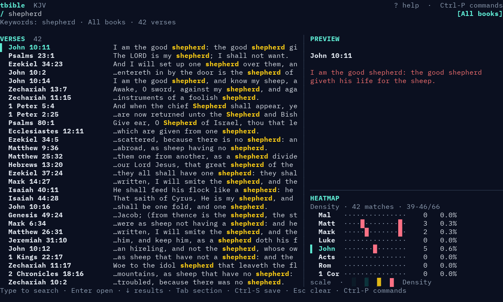
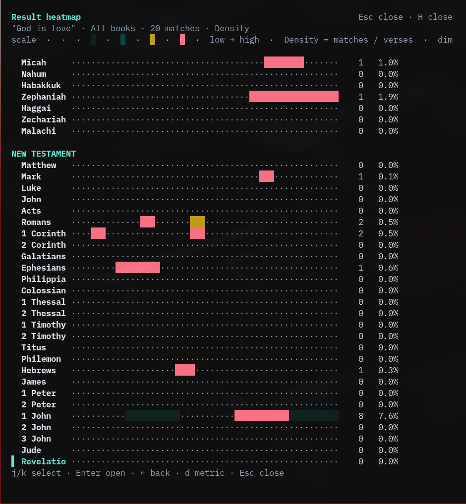

# tbible — Terminal Bible (KJV)



`tbible` is a keyboard-driven King James Bible for your terminal. Search a
word, jump straight to a passage, read it with proper typography and notes, and
keep your own bookmarks and notes. The whole Bible and its search index are
built into one executable, so there is nothing to install separately and no
database to build.

v2 is the current release. Windows 11 with Windows Terminal is the primary
target; Linux and macOS are fully supported. The original bash/fzf application
is still available as [legacy v1](legacy/v1/README.md) on the `v1` branch.

## Features

- **Fast.** Cold start plus the first search is roughly 20 ms, and repeated
  searches take tens of microseconds. Search stays instant even on a large
  terminal window.
- **Complete, verified KJV text.** All 66 books, 1,189 chapters, and 31,102
  verses, with the text checked against the canonical eBible.org `eng-kjv2006`
  edition.
- **One search box.** Type a reference, a range, a phrase, a prefix, or a word
  with exclusions. No modes to switch and no separate reference lookup.

  ```text
  John 3:16          a single verse
  1 Cor 13:4-7       a verse range
  John 3-5           a chapter range
  John 3:16-5:2      a range across chapters
  "still waters"     an exact phrase
  love -world        include love, exclude world
  shep*              words beginning with "shep"
  john 3:16; rom 5:8 several references at once
  ```

- **A readable Bible view.** Verse numbers, paragraphs, poetry, section
  headings, psalm titles, red-letter text, supplied-word italics, KJV marginal
  notes, and your own notes inline with a distinct `✎` marker.
- **Result heatmap.** See where your search terms cluster across all 66 books,
  open a book to see its chapters, and switch between intensity and raw counts.
  On wide terminals, a live mini heatmap follows the selected result.

  

- **Calendar view.** Browse notes, bookmarks, and reading history by date in a
  Sunday-first heatmap. Colours show the dominant source for each day, and you
  can filter the entries shown for that day.
- **Your own library.** Save bookmarks, write notes, revisit reading history,
  and keep named searches. Your data is stored locally as one JSON file; if it
  becomes unreadable, the original is backed up rather than overwritten.
- **Keyboard-only.** Every action has a key. Press `?` in the app for the full
  list.
- **Copy and script.** Copy a verse or a whole range with one key, or use the
  same executable from a script:

  ```sh
  tbible --read "John 3:16"
  tbible --search shepherd
  tbible --search "John 3:16; Romans 5:8" --json
  ```

## What's new compared with v1

- **No setup.** v1 needed bash, fzf, sqlite3, Python, and a generated database.
  v2 is a single executable with the text and index already inside it.
- **Much faster.** v1 paid shell and database startup costs on every run. v2
  opens and searches in milliseconds.
- **Better search.** Results are ranked by relevance, and phrases, prefixes,
  exclusions, scopes, and multi-reference ranges all live in the same box.
- **A real reading view.** v1 showed plain search results and previews. v2 adds
  typography, headings, poetry, red-letter text, and both KJV and personal
  notes inline.
- **A personal library.** v1 did not save bookmarks, notes, or history. v2 does,
  and adds a calendar so you can see your activity by date.
- **Corrected text.** The source used by v1 had 31,100 verses and had dropped or
  shifted a few well-known readings. v2 ships a checked 31,102-verse text.
- **Better Windows support.** v2 has a native Windows executable and works best
  in Windows Terminal; there is no fzf, SQLite, or Python dependency.

The v1 application is still supported for people who prefer its workflow. New
features go into v2.

## Install

Prebuilt binaries are attached to the v2.0.0 release. The installers download
the right archive for your system and verify it against the published SHA-256
checksums. If you prefer to build from source, the instructions are below.

### Linux

**Install the released binary (recommended):**

```sh
curl -fsSL https://raw.githubusercontent.com/petealeon/tbible/main/install.sh | bash
```

The binary is installed to `~/.local/bin/tbible` by default. Add that directory
to your `PATH` if it is not already there. To choose another location:

```sh
curl -fsSL -o install.sh \
  https://raw.githubusercontent.com/petealeon/tbible/main/install.sh
chmod +x install.sh
./install.sh --bin-dir "$HOME/bin" --desktop
```

The `--desktop` flag also installs a Linux desktop entry.

**Build from source on Linux:**

Requirements: Go 1.27 or newer, `git`, and optionally `make`. For clipboard
copying, install `wl-copy`, `xclip`, or `xsel`.

```sh
git clone https://github.com/petealeon/tbible.git
cd tbible
./install.sh --source
tbible --version
```

### macOS

**Install the released binary (recommended):**

```sh
curl -fsSL https://raw.githubusercontent.com/petealeon/tbible/main/install.sh | bash
```

The binary is installed to `~/.local/bin/tbible` by default. If macOS blocks
the first launch, run:

```sh
xattr -d com.apple.quarantine ~/.local/bin/tbible
```

You can also build from source, which avoids Gatekeeper entirely.

**Build from source on macOS:**

Requirements: Go 1.27 or newer (`brew install go` works), `git` from the Xcode
Command Line Tools, and optionally `make`. `pbcopy` for clipboard copying is
built in.

```sh
git clone https://github.com/petealeon/tbible.git
cd tbible
./install.sh --source
tbible --version
```

### Windows

Windows 11 with Windows Terminal is recommended. Older Windows versions may
work, but Windows Terminal gives the best layout and colour support.

**Install the released binary (recommended):**

Open PowerShell and run:

```powershell
powershell -ExecutionPolicy Bypass -Command "irm https://raw.githubusercontent.com/petealeon/tbible/main/scripts/install.ps1 | iex"
```

The binary is installed to `%LOCALAPPDATA%\Programs\tbible\tbible.exe`. To add
that folder to your user `PATH`, download the installer first and run it with
`-AddToPath`:

```powershell
irm https://raw.githubusercontent.com/petealeon/tbible/main/scripts/install.ps1 -OutFile install.ps1
powershell -ExecutionPolicy Bypass -File .\install.ps1 -AddToPath
```

If SmartScreen warns about an unsigned first release, verify the published
checksum, then choose **More info → Run anyway**.

**Build from source on Windows:**

Requirements: Go 1.27 or newer from <https://go.dev/dl/>, PowerShell 5.1 or
newer, and Git for Windows for the commands below. `clip.exe` for clipboard
copying is built in.

```powershell
git clone https://github.com/petealeon/tbible.git
cd tbible
powershell -ExecutionPolicy Bypass -File .\scripts\install.ps1 -Source
.\bin\tbible.exe --version
```

To install a prebuilt binary from a local checkout instead:

```powershell
powershell -ExecutionPolicy Bypass -File .\scripts\install.ps1
```

## A quick tour

Run `tbible` with no arguments. The search box is focused at launch. Type a
reference or a query, move with the arrow keys, and press `Enter` to open what
you selected.

| Key | Action |
| --- | --- |
| `/` | Focus the search box |
| `↑` `↓` | Move through results or verses |
| `Enter` | Open the selected result |
| `f` | Change search scope, or filter Calendar entries |
| `H` | Open the full result heatmap |
| `L` | Open the Library |
| `Ctrl-P` | Command palette |
| `y`, `b`, `n` | Copy, bookmark, or add a note |
| `i` | Show or hide KJV and personal notes |
| `?` | Help |
| `Ctrl-C` | Quit |

In the Library, use `Tab` to switch between All, Bookmarks, Notes, History,
Saved searches, and Calendar. In Calendar, use `h`/`l` to move by day, `[`/`]`
to move by month, `1`–`4` to choose a source, and `Enter` to open an entry.

## Your data

Your notes, bookmarks, history, and saved searches are stored locally:

- Windows: `%AppData%\tbible\state.json`
- macOS: `~/Library/Application Support/tbible/state.json`
- Linux: `~/.config/tbible/state.json`

Set `TBIBLE_STATE_DIR` if you want to store the file somewhere else, such as on
portable media. If the file is damaged or comes from a newer version, it is
renamed with a `.corrupt` suffix and the app starts with a warning.

v1 did not save user notes, bookmarks, or history, so there is nothing to
migrate. You can keep using v1 or start fresh in v2.

## Legacy v1

The original application is preserved in [`legacy/v1/`](legacy/v1/README.md) and
on the `v1` branch. It uses bash, fzf, sqlite3, and Python. It remains available
and supported, but new features are developed for v2.

## License and KJV notice

This project is licensed under the terms in [LICENSE](LICENSE).

The King James Version is in the public domain in the United States and most of
the world outside the United Kingdom. In the United Kingdom the Authorized
Version is subject to Crown copyright; this project does not grant any rights
to the KJV text and is not affiliated with the Crown.

The text used here is eBible.org's `eng-kjv2006` edition, which states that it
is public domain outside the UK. The eBible source includes Strong's numbers
and footnotes; v2 keeps the KJV marginal notes but does not display Strong's
numbers.
